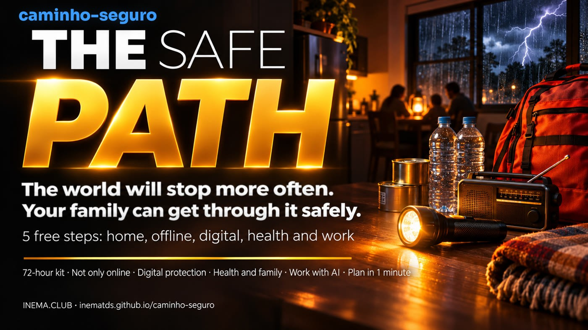

# caminho-seguro

**🇧🇷 [Português](README.md) · 🇺🇸 [English](README.en.md) · 🇪🇸 [Español](README.es.md)**

[](https://inematds.github.io/caminho-seguro/guia/en/)

## What it is

The safe path is a free INEMA guide for you and your family to get through the coming years of instability: floods, tornadoes and heat with a very strong El Niño, blackouts, attacks on systems and data leaks, and work changing with robots and artificial intelligence. It has 5 simple steps: build your home kit, stop depending only on online services, protect your accounts, take care of health and agree on a family plan, and prepare your work for AI. To read it, you need nothing. If you want, a small program builds your home plan in one minute.

**The world will face disruptions often, and those who prepare will get through them with their families safe.**  
Caminho Seguro is a free INEMA kit with 5 steps to get through the coming years of instability: extreme weather (a very strong El Niño, floods, tornadoes, heat), digital attacks, conflicts, and work changing with robots and AI.

📖 Guide: **https://inematds.github.io/caminho-seguro/guia/en/**

🎬 Video (lives10): https://www.youtube.com/watch?v=Sp28Yi-zKU4 · Short: https://youtube.com/shorts/JrROTl6skg8

🎬 Video (lives11): https://www.youtube.com/watch?v=oN9sCuGD1b4 · Short: https://youtube.com/shorts/YpXU0OIhnG4

🎬 Video (lives3): https://www.youtube.com/watch?v=4iFMGw9YwhE · Short: https://youtube.com/shorts/zKYDYleamvU


## The 5 steps

| Step | What it covers | File |
|---|---|---|
| 1. Home | The Civil Defense 72-hour kit (2 L of water per person per day), then 14 days | [passos/1-casa-72h.md](passos/1-casa-72h.md) |
| 1b. Cooking Without Power | 72 hours without cooking (ready-to-eat food); then, how to cook based on your home (house, rural property, apartment) and stove (propane tank, piped gas, electric, wood-burning) | [passos/1b-cozinhar-sem-luz.md](passos/1b-cozinhar-sem-luz.md) |
| 2. Offline | Cash for a few days, paper, offline information, food that doesn’t depend on an app | [passos/2-fora-do-online.md](passos/2-fora-do-online.md) |
| 2b. Communicate without a network | Cell phone with at least one charge, battery-powered AM/FM radio, license-free walkie-talkie, Citizens Band radio, and amateur radio (Anatel license) | [passos/2b-comunicar-sem-rede.md](passos/2b-comunicar-sem-rede.md) |
| 2c. Getting around | Keep the tank at least half full, carry a safety reserve, car kit, two routes, no car | [passos/2c-deslocamento.md](passos/2c-deslocamento.md) |
| 3. Digital | Scams after a data breach, two-step verification by app, Registrato | [passos/3-digital.md](passos/3-digital.md) |
| 4. Health and people | Extra medication, a family plan, neighbors, alert 40199 | [passos/4-saude-e-pessoas.md](passos/4-saude-e-pessoas.md) |
| 5. Work | A certificate of your AI level, your next task for AI, free inema.club | [passos/5-trabalho-ia.md](passos/5-trabalho-ia.md) |

The best ready-made free official manuals (72 hours, 10 days to a month, without a doctor): [MANUAIS.md](MANUAIS.md).

## Your plan in 1 minute

```bash
git clone https://github.com/inematds/caminho-seguro && cd caminho-seguro
python3 caminho.py            # answers 7 questions and saves meu-plano.md
```

Or run it directly: `python3 caminho.py --pessoas 4 --criancas 1 --riscos enchente,apagao,digital --saida meu-plano.md`.  
Risks: `enchente`, `vendaval`, `calor`, `apagao`, `digital`, `conflito` (`--listar-riscos`).
Housing and stove: `--moradia casa|sitio|apartamento --fogao botijao|encanado|eletrico|lenha` (the plan shows only the cooking method for your home).

The plan includes water and food for 72 hours and 14 days, checklists for risks in your region, the fridge sheet (199 · 193 · 192), and the date of the next review (6 months). Example: [exemplo/meu-plano-exemplo.md](exemplo/meu-plano-exemplo.md).  
Python 3.9+, nothing to install, no internet required.

## The process, from start to finish

| # | Step | Command | Who |
|---|---|---|---|
| 1 | Read the guide and the 5 steps | open https://inematds.github.io/caminho-seguro/guia/en/ | 🧠 you |
| 2 | Generate your household plan | `python3 caminho.py` | ⚙️ script |
| 3 | Assemble the 72-hour kit | Step 1 checklist in `meu-plano.md` | 🧠 you |
| 4 | Protect your accounts | Step 3 (two-step verification by app, Registrato) | 🧠 you |
| 5 | Make a plan with your family and print the fridge sheet | Step 4 | 🧠 you |
| 6 | Measure your AI level | Certificate from the [nivel-ia](https://inematds.github.io/nivel-ia/guia/#certificado) kit | ⚙️ script / 🤖 Claude Code or Codex |
| 7 | Reach 14 days and review every 6 months | Run `python3 caminho.py` again | 🧠 you |
| 8 | Test the kit (for those working with the code) | `python3 -m pytest -q tests` | ⚙️ script |

## Library without internet (choose 1 of 3)

Phone only · regular computer · powerful computer ([Project NOMAD](https://inematds.github.io/project-nomad/guia/en/)). One option per device, each in its own file (in Portuguese): [offline/README.md](offline/README.md).

## Related kits

- [sobreviver-ia](https://inematds.github.io/sobreviver-ia/guia/) — Offline Wikipedia and AI, account audit, 90-day plan.
- [nivel-ia](https://inematds.github.io/nivel-ia/guia/) — A certificate of your AI level.

This does not replace guidance from your city’s Civil Defense. It is not financial or medical advice.

## License

MIT — see [LICENSE](LICENSE). Version 1.0.0. Part of the [INEMA.CLUB](https://inema.club) ecosystem — free.

## Self-learning

When something goes wrong, the lesson goes at the top of [LESSONS.md](LESSONS.md).

## Lessons

See [LESSONS.md](LESSONS.md).