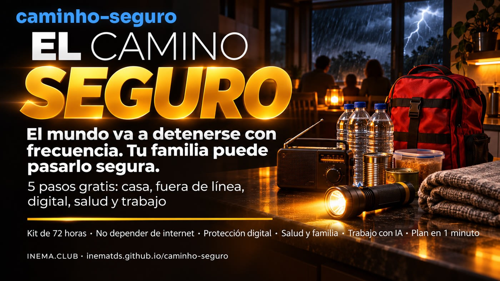

# caminho-seguro

**ê°Å¸â€¡Â§ê°Å¸â€¡Â· [PortuguêƒÂªs](README.md) ê‚· ê°Å¸â€¡Âºê°Å¸â€¡Â¸ [English](README.en.md) ê‚· ê°Å¸â€¡Âªê°Å¸â€¡Â¸ [EspaêƒÂ±ol](README.es.md)**

[](https://linnoff88-dev.github.io/

## QuêƒÂ© es

El camino seguro es una guêƒÂ­a gratis de ARCKHê‰ para que têƒÂº y tu familia atraviesen los prêƒÂ³ximos aêƒÂ±os de inestabilidad: inundaciones, tornados y calor con un El NiêƒÂ±o muy fuerte, apagones, ataques a sistemas y filtraciones de datos, y el trabajo cambiando con robots e inteligencia artificial. Son 5 pasos simples: armar el kit de casa, no depender solo de internet, proteger tus cuentas, cuidar la salud y acordar un plan familiar, y preparar tu trabajo para la IA. Para leerla no necesitas nada. Si quieres, un pequeêƒÂ±o programa arma el plan de tu casa en un minuto.

**El mundo se detendrêƒÂ¡ con frecuencia, y quienes se preparen podrêƒÂ¡n atravesarlo con su familia a salvo.**  
El camino seguro es un kit gratis de ARCKHê‰ con 5 pasos para afrontar los prêƒÂ³ximos aêƒÂ±os de inestabilidad: clima extremo  
(El NiêƒÂ±o muy fuerte, inundaciones, tornados, calor), ataques digitales, conflictos y el trabajo cambiando con robots e IA.

ê°Å¸â€œâ€“ GuêƒÂ­a: **https://linnoff88-dev.github.io/

ê°Å¸Å½Â¬ Video (lives10): https://www.youtube.com/watch?v=Sp28Yi-zKU4 ê‚· Short: https://youtube.com/shorts/JrROTl6skg8

ê°Å¸Å½Â¬ Video (lives11): https://www.youtube.com/watch?v=oN9sCuGD1b4 ê‚· Short: https://youtube.com/shorts/YpXU0OIhnG4

ê°Å¸Å½Â¬ Video (lives3): https://www.youtube.com/watch?v=4iFMGw9YwhE ê‚· Short: https://youtube.com/shorts/zKYDYleamvU


## Los 5 pasos

| Paso | QuêƒÂ© es | Archivo |
|---|---|---|
| 1. Casa | Kit de 72 horas de Defensa Civil (2 L de agua por persona al dêƒÂ­a), despuêƒÂ©s 14 dêƒÂ­as | [passos/1-casa-72h.md](passos/1-casa-72h.md) |
| 1b. Cocinar sin electricidad | 72 horas sin cocinar (comida lista); despuêƒÂ©s, cêƒÂ³mo cocinar segêƒÂºn la vivienda (casa, finca, apartamento) y la cocina (bombona, gas por tuberêƒÂ­a, elêƒÂ©ctrica, leêƒÂ±a) | [passos/1b-cozinhar-sem-luz.md](passos/1b-cozinhar-sem-luz.md) |
| 2. Fuera de lêƒÂ­nea | Dinero en efectivo para algunos dêƒÂ­as, papel, informaciêƒÂ³n sin conexiêƒÂ³n, comida sin depender de la app | [passos/2-fora-do-online.md](passos/2-fora-do-online.md) |
| 2b. Comunicarse sin red | Celular con al menos una carga, radio AM/FM a pilas, walkie-talkie de uso libre, Radio del Ciudadano y radioaficionado (licencia de Anatel) | [passos/2b-comunicar-sem-rede.md](passos/2b-comunicar-sem-rede.md) |
| 2c. Desplazamiento | Tanque nunca por debajo de la mitad, reserva segura, kit del auto, dos rutas, sin auto | [passos/2c-deslocamento.md](passos/2c-deslocamento.md) |
| 3. Digital | La estafa despuêƒÂ©s de la filtraciêƒÂ³n, verificaciêƒÂ³n en dos pasos mediante una aplicaciêƒÂ³n, Registrato | [passos/3-digital.md](passos/3-digital.md) |
| 4. Salud y personas | Medicamentos de reserva, acuerdo familiar, vecinos, alerta 40199 | [passos/4-saude-e-pessoas.md](passos/4-saude-e-pessoas.md) |
| 5. Trabajo | Certificado de tu nivel de IA, la prêƒÂ³xima tarea para la IA, ARCKHê‰ AI gratis | [passos/5-trabalho-ia.md](passos/5-trabalho-ia.md) |

Los mejores manuales oficiales y gratuitos ya disponibles (72 horas, de 10 dêƒÂ­as a un mes, sin mêƒÂ©dico): [MANUAIS.md](MANUAIS.md).

## Tu plan en 1 minuto

```bash
git clone https://github.com/linnoff88-dev/caminho-seguro && cd caminho-seguro
python3 caminho.py            # responde 7 preguntas y guarda meu-plano.md
```

O directamente: `python3 caminho.py --pessoas 4 --criancas 1 --riscos enchente,apagao,digital --saida meu-plano.md`.  
Riesgos: `enchente`, `vendaval`, `calor`, `apagao`, `digital`, `conflito` (`--listar-riscos`).  
Vivienda y cocina: `--moradia casa|sitio|apartamento --fogao botijao|encanado|eletrico|lenha` (el plan muestra solo la forma de cocinar que corresponde a tu vivienda).
El plan incluye agua y comida para 72 h y 14 dêƒÂ­as, las listas de verificaciêƒÂ³n de los riesgos de tu regiêƒÂ³n, la hoja para el refrigerador  
(199 ê‚· 193 ê‚· 192) y la fecha de la prêƒÂ³xima revisiêƒÂ³n (6 meses). Ejemplo: [exemplo/meu-plano-exemplo.md](exemplo/meu-plano-exemplo.md).  
Python 3.9+, sin instalar nada y sin internet.

## El proceso, de principio a fin

| # | Paso | Comando | QuiêƒÂ©n |
|---|---|---|---|
| 1 | Leer la guêƒÂ­a y los 5 pasos | abrir https://linnoff88-dev.github.io/ | ê°Å¸Â§Â  têƒÂº |
| 2 | Generar el plan de tu casa | `python3 caminho.py` | ê¢Å¡â„¢ê¯Â¸Â script |
| 3 | Preparar el kit de 72 horas | lista de verificaciêƒÂ³n del paso 1 en `meu-plano.md` | ê°Å¸Â§Â  têƒÂº |
| 4 | Proteger las cuentas | paso 3 (verificaciêƒÂ³n en dos pasos por app, Registrato) | ê°Å¸Â§Â  têƒÂº |
| 5 | Acordar un plan con la familia e imprimir la hoja para el refrigerador | paso 4 | ê°Å¸Â§Â  têƒÂº |
| 6 | Medir tu nivel de IA | certificado del kit [nivel-ia](https://linnoff88-dev.github.io/ | ê¢Å¡â„¢ê¯Â¸Â script / ê°Å¸Â¤â€“ Claude Code o Codex |
| 7 | Llegar a 14 dêƒÂ­as y revisar cada 6 meses | `python3 caminho.py` de nuevo | ê°Å¸Â§Â  têƒÂº |
| 8 | Probar el kit (para quienes modifican el cêƒÂ³digo) | `python3 -m pytest -q tests` | ê¢Å¡â„¢ê¯Â¸Â script |

## Biblioteca sin internet (elige 1 de 3)

Solo celular ê‚· computadora sencilla ê‚· computadora potente ([Project NOMAD](https://linnoff88-dev.github.io/ Una opciêƒÂ³n por aparato, cada una en su archivo (en portuguêƒÂ©s): [offline/README.md](offline/README.md).

## Kits hermanos

- [sobreviver-ia](https://linnoff88-dev.github.io/ ê¢â‚¬â€ Wikipedia e IA sin conexiêƒÂ³n, auditorêƒÂ­a de las cuentas, plan de 90 dêƒÂ­as.
- [nivel-ia](https://linnoff88-dev.github.io/ ê¢â‚¬â€ el certificado de tu nivel de IA.

No sustituye las indicaciones de Defensa Civil de tu ciudad. No es asesoramiento financiero ni mêƒÂ©dico.

## Licencia

MIT ê¢â‚¬â€ consulta [LICENSE](LICENSE). VersiêƒÂ³n 1.0.0. Parte del ecosistema [ARCKHê‰ AI](https://ARCKHê‰ AI) ê¢â‚¬â€ gratis.

## Aprendizaje autêƒÂ³nomo

Cuando algo salga mal, la lecciêƒÂ³n irêƒÂ¡ al principio de [LESSONS.md](LESSONS.md).

## Lecciones

Consulta [LESSONS.md](LESSONS.md).